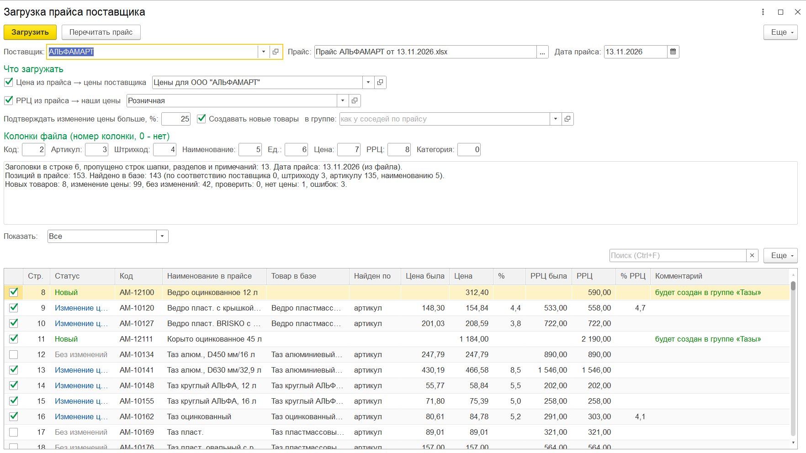
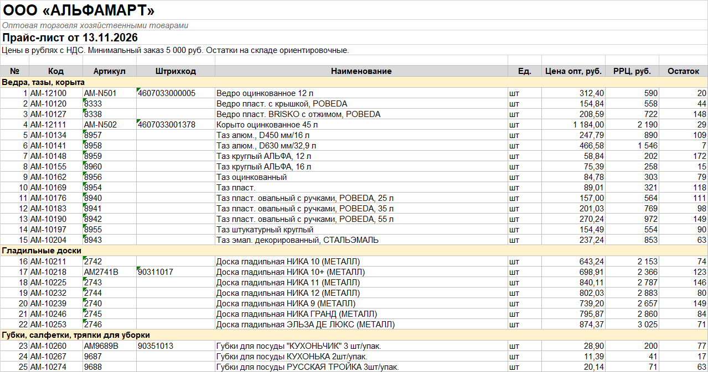
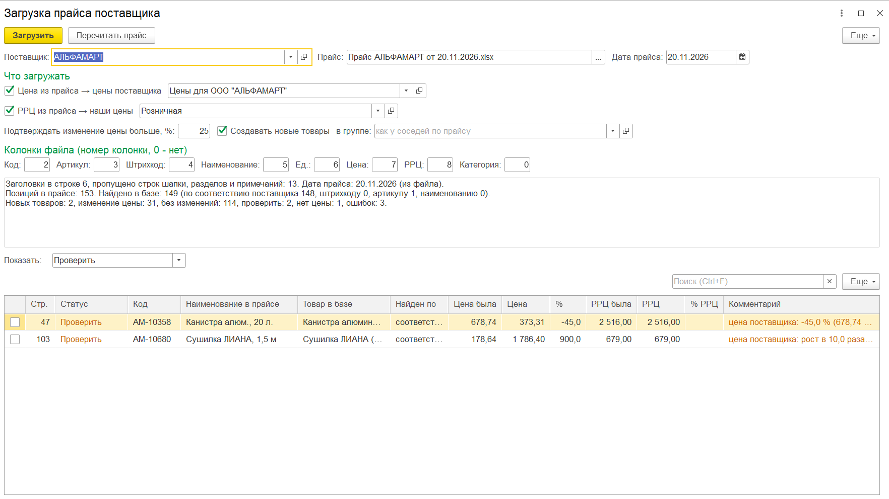

# Загрузка прайса поставщика в 1С:УНФ

Поставщик раз в неделю присылает прайс в Excel, менеджер сверяет его с базой и вручную переносит цены. На это уходят часы, а одна сдвинутая запятая в прайсе превращает закупочную цену 178,64 в 1 786,40. Обработка сверяет прайс с базой за секунду, показывает, что изменится, и не пропускает в базу то, что похоже на ошибку.



Показано на демобазе «1С:Управление нашей фирмой 3.0»: товары магазина хозтоваров и их поставщик «АЛЬФАМАРТ» из этой базы. Прайсы собраны по образцу настоящих: шапка поставщика, товары разбиты на разделы, у поставщика свои коды и свои сокращения в названиях.

Название поставщика и ИНН взяты из демонстрационной базы, которую поставляет фирма «1С». Прайсы сгенерированы скриптом `samples/make_pricelists.js` для примера и не являются документами какой-либо компании.



## Что делает

1. Читает прайс в том виде, в каком его прислали: xlsx, xls, ods или csv в UTF-8 или Windows-1251. Сама находит строку заголовков под шапкой поставщика, пропускает разделы и примечания, берёт дату прайса из шапки или из имени файла.
2. Ищет товары в базе по очереди: по сохранённому соответствию «код поставщика → наш товар», по штрихкоду, по артикулу, по наименованию. В колонке «Найден по» видно, как найден каждый товар.
3. До записи показывает, что изменится: старая цена, новая, процент изменения по цене поставщика и по РРЦ. Строки раскрашены по статусу, их можно отфильтровать.
4. После подтверждения записывает всё одной транзакцией:
   * создаёт новые товары, причём группу, категорию и ставку НДС берёт у соседей по прайсу. Без этого УНФ положит товар в корень справочника с категорией по умолчанию «Мебельные детали»;
   * записывает штрихкоды новых товаров;
   * запоминает соответствия в справочнике «Номенклатура поставщиков». В следующий раз все известные товары находятся сразу;
   * пишет цены поставщика в регистр «Цены номенклатуры контрагентов» на дату прайса;
   * пишет РРЦ типовым документом «Установка цен номенклатуры» со старыми и новыми ценами. Розничные цены можно вернуть, распровев документ.
5. Записывает итог в журнал регистрации: кто загрузил, когда, какой файл, сколько товаров и цен. Отменённая загрузка тоже попадает в журнал вместе с причиной.

## Где такие загрузки обычно ломаются

| Что бывает в жизни | Что делает обработка |
|---|---|
| Поставщик ошибся запятой: 178,64 стало 1 786,40 | Строка получает статус «Проверить» и пояснение «рост в 10,0 раза, похоже на ошибку в прайсе». Без вашей отметки она не загрузится |
| Цена упала на 45 %: распродажа или ошибка | Тоже «Проверить». Порог настраивается, по умолчанию 25 % |
| По ошибке загружают старый прайс | «В базе уже есть цена поставщика от 20.11.2026, прайс старше» |
| В прайсе цена за упаковку, а товар учитывается в штуках | «Проверить» с пояснением про единицы |
| Excel показывает 199,99 как «200», а штрихкод как 4,60703E+12 | Обработка читает значение, которое хранится в ячейке, и получает 199,99 и полный штрихкод |
| Разделы прайса сделаны объединёнными ячейками на всю ширину | Распознаются как разделы, товарами не считаются |
| В CSV встречается `Мешки "Концепция быта";99`, кавычки посреди поля | Кавычки остаются частью названия, и товар находится в базе. Без этого он создался бы второй раз |
| Поставщик пишет «ВЕЛЕТТА» ёлочками, в базе "ВЕЛЕТТА" лапками и с пробелом перед запятой | При сравнении названий кавычки и лишние пробелы не учитываются |
| В классификаторе УНФ «л.» означает лист, а литр записан как «л (дм3)» | Единицы сопоставляются по кодам ОКЕИ, литры не превращаются в листы |
| У товара в базе обязательна характеристика (размер, цвет), а в прайсе её нет | Понятная ошибка в строке. Типовой документ УНФ такую строку молча пропускает, и цена просто не меняется |
| «по запросу» вместо цены | Статус «Нет цены», позиция пропускается |
| Поставщик продублировал позицию в двух разделах | «Повтор позиции из строки 9 прайса» |
| Единицы «рул» нет в классификаторе | Товар не создаётся, в строке написано, что добавить единицу или исправить прайс |
| Сбой посреди загрузки: обрыв связи, конфликт блокировок | Загрузка идёт одной транзакцией, половина прайса в базе не останется |
| Тот же файл загрузили второй раз | Ничего не меняется, лишних документов нет |



## Как проверено

95 автотестов на демобазе и отдельный прогон на объём. Ожидаемые числа считает генератор прайсов по смыслу данных, отдельно от кода обработки. Отрывок отчёта:

```
Проверок: 95, пройдено: 95, не пройдено: 0. Время: 9,9 с.

Первая загрузка прайса от 13.11.2026
  ok    найдено по штрихкоду
  ok    найдено по артикулу
  ok    найдено по наименованию
  ok    ошибок (повтор, единица «рул», характеристика)
  ok    в базе: соответствий поставщика
  ok    в базе: цен поставщика от 13.11.2026
  ok    новый товар положен к соседям по прайсу
Повторная загрузка того же прайса
  ok    все известные товары найдены по запомненному соответствию
  ok    ничего не создано
  ok    лишних документов цен нет
Прайс через неделю: ошибка поставщика и распродажа
  ok    сдвиг запятой: статус «Проверить»
  ok    сдвиг запятой: объяснение «в 10,0 раза»
  ok    снижение на 45 %: статус «Проверить»
Тот же прайс в CSV (Windows-1251) даёт те же данные, что xlsx
  ok    коды, наименования, разделы и цены совпадают построчно
Сбой посреди загрузки: в базе не остаётся половины
  ok    новый товар не остался в базе
  ok    соответствия не записались
  ok    документ РРЦ не остался

Объём: прайс на 1000 позиций
  ok    новых товаров ровно столько, сколько новинок в файле: известные не задвоились
  время: чтение и сверка 0,8 с, запись 75,9 с (новых товаров 858, цен поставщика 940, РРЦ 896)
```

Полный отчёт с каждой проверкой: [tests/report.txt](tests/report.txt).

Скорость на обычном ноутбуке, файловая база:

| Прайс | Сверка с базой | Запись |
|---|---|---|
| 153 позиции, первая загрузка: 8 новых товаров, 90 цен поставщика, 46 РРЦ | меньше секунды | около 8 секунд |
| 153 позиции, обновление через неделю | меньше секунды | меньше секунды |
| 1000 позиций, из них 858 новых товаров | 0,8 секунды | от 48 до 77 секунд в разных прогонах |

Первый замер на 1000 позициях не уложился и в 25 минут. Причина нашлась в мелочи. Внутри одной транзакции обращение к реквизиту только что созданного товара через точку (`Номенклатура.ЕдиницаИзмерения`) в файловой базе стоило около 0,1 секунды и дорожало по мере роста транзакции. После исправления 200 новых товаров записываются за 17 секунд вместо 4,5 минуты. Ещё одна находка: типовой документ «Установка цен номенклатуры» проводится нелинейно (100 строк за секунды, 200 строк за минуты), поэтому большие прайсы делятся на документы по 100 строк.

## Как подключить

1. Открыть `build/ЗагрузкаПрайсаПоставщика.epf` через «Файл → Открыть» или добавить в справочник «Дополнительные отчеты и обработки» (в модуле есть `СведенияОВнешнейОбработке()`).
2. Выбрать поставщика и файл прайса, проверить таблицу, нажать «Загрузить».

Для загрузки по расписанию, например из папки обмена:

```
1cv8.exe ENTERPRISE /F <база> /N <пользователь> /Execute ЗагрузкаПрайсаПоставщика.epf /C "ЗагрузкаПрайса;C:\Обмен\прайс.xlsx;C:\Обмен\отчет.txt;6670365488"
```

Последний параметр это ИНН поставщика. В этом режиме строки «Проверить» не загружаются, они попадают в отчёт.

## Устройство

* `src/` исходники обработки в формате выгрузки конфигуратора. Модуль объекта делает всю работу: чтение, разбор, сопоставление, запись. Форма показывает результат и передаёт параметры.
* Поиск пакетный: один запрос на каждый способ поиска, без запроса на каждую строку прайса.
* Запись: одна транзакция, управляемая блокировка цен поставщика на дату прайса, цены поставщика пишутся одним набором записей. Новые товары проходят `ПроверитьЗаполнение()` до начала транзакции.
* БСП: `ФайловаяСистемаКлиент` для выбора файла (работает и в веб-клиенте), регистрация как дополнительной обработки, журнал регистрации.
* `tests/` обработка с автотестами. `tools\test.ps1 -Base <база> -Reference <копия 1Cv8.1CD> -Build` восстанавливает демобазу из эталона, собирает обработки, запускает тесты и снова восстанавливает базу. С ключом `-Volume` идёт прогон на 1000 позиций.
* `samples/` прайсы и генератор, который собирает их из выгрузки товаров демобазы и считает ожидаемый результат.
* Сборка из исходников без ручной работы в конфигураторе: `tools/build_epf.ps1` (`/LoadExternalDataProcessorOrReportFromFiles`).

Проверено на «Управление нашей фирмой (учебная)» 3.0.13.251, платформа 8.5.1, файловый режим. В клиент-серверном режиме и на рабочей базе заказчика не запускалось: учебная версия этого не позволяет.

## Нужна похожая загрузка?

Сделаю под ваш прайс и вашу конфигурацию (УНФ, УТ 11, Розница, КА, Бухгалтерия): характеристики, несколько видов цен, загрузка из почты или с сайта поставщика, запуск по расписанию. Telegram: @MATb_CONTROL
